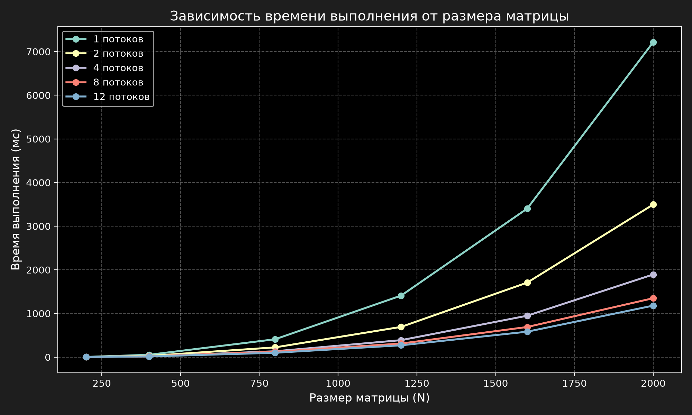
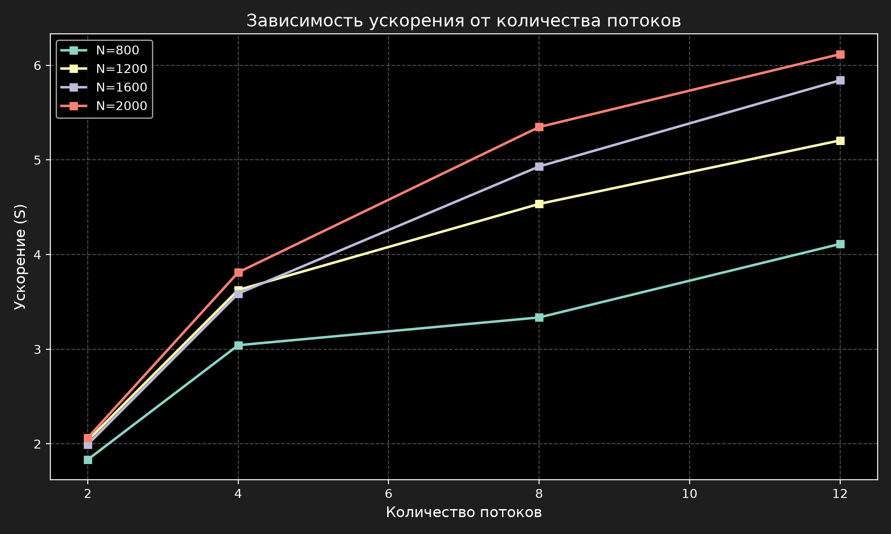

# Отчет по лабораторной работе №2

**Тема:** Параллельное умножение матриц с использованием OpenMP

**Студент:** Судаков Антон

**Группа:** 6211-10.05.03

---
## 1. Цель работы
Модифицировать программу умножения матриц из первой лабораторной для параллельной работы с помощью технологии OpenMP. Провести замеры времени при разном количестве потоков и размерах матриц, посчитать ускорение и эффективность.

## 2. Что было сделано
В исходный код из Лабы №1 были внесены следующие изменения:
1. Подключен заголовочный файл `#include <omp.h>`.
2. Перед внешним циклом `for (int i = 0; ...)` в функции `MultiplyMatrix` добавлена директива `#pragma omp parallel for num_threads(n)`, где n - количество потоков.
3. Проект собирался в конфигурации **Release x64**, в отличие от первой лабораторной.

## 3. Результаты замеров

Замерялось время только самого умножения. Размеры матриц: 200, 400, 800, 1200, 1600, 2000. Количество потоков: 1, 2, 4, 8, 12.

### Время выполнения (в мс)

| Размер (N) | 1 поток | 2 потока | 4 потока | 8 потоков | 12 потоков |
| :--- | :--- | :--- | :--- | :--- | :--- |
| 200 | 4.80 | 3.89 | 4.75 | 4.15 | 5.91 |
| 400 | 53.48 | 27.77 | 17.14 | 17.62 | 15.38 |
| 800 | 409.15 | 223.16 | 134.51 | 122.68 | 99.51 |
| 1200 | 1409.74 | 692.72 | 388.84 | 310.90 | 270.82 |
| 1600 | 3402.92 | 1706.86 | 948.51 | 690.24 | 582.66 |
| 2000 | 7217.63 | 3497.10 | 1893.67 | 1349.89 | 1180.05 |

### Ускорение и эффективность (для N=2000)

Ускорение (S) = Время(1 поток) / Время(N потоков)

Эффективность (E) = Ускорение / Количество потоков

| Потоки | Время (мс) | Ускорение (S) | Эффективность (E) |
| :--- | :--- | :--- | :--- |
| 1 | 7217.63 | 1.00 | 100% |
| 2 | 3497.10 | 2.06 | 103% |
| 4 | 1893.67 | 3.81 | 95% |
| 8 | 1349.89 | 5.35 | 67% |
| 12 | 1180.05 | 6.12 | 51% |

## 4. Графики

## 5. Вывод

По результатам экспериментов можно сделать следующие выводы:

1. На маленьких матрицах (N=200, 400) параллелизм не работает. Время с 4 или 8 потоками может быть даже больше, чем с одним. Это объясняется накладными расходами: процессор тратит время на создание потоков и их синхронизацию, а сама математика занимает меньше времени, чем эти расходы.

2. На больших матрицах (N=800 и выше) ускорение появляется. Максимальное ускорение составило **6.12x** на матрице **2000x2000** при **12** потоках.

3. После 8 потоков рост ускорения замедляется. Эффективность падает с 95% (на 4 потоках) до 51% (на 12 потоках).
