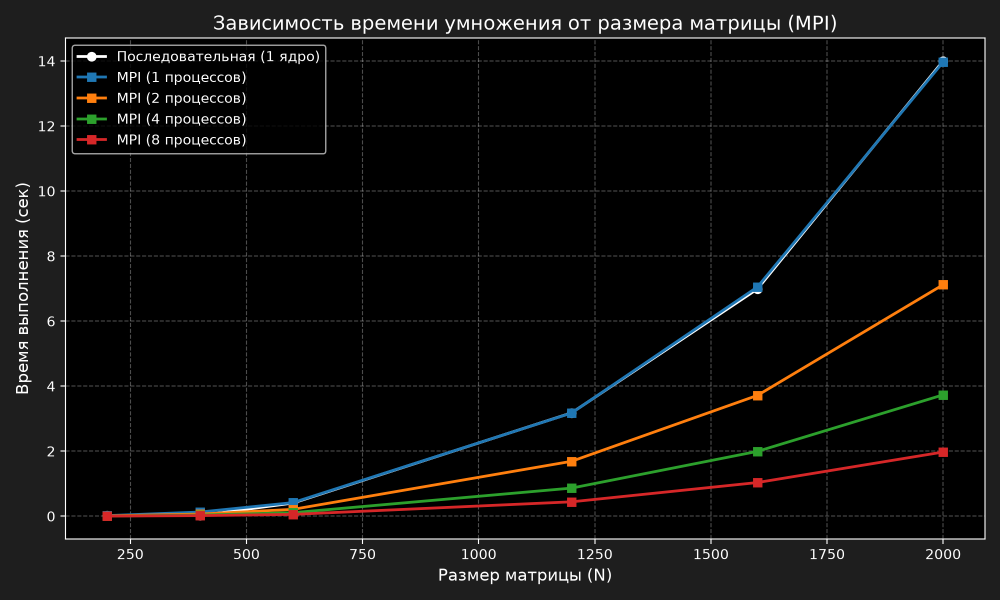
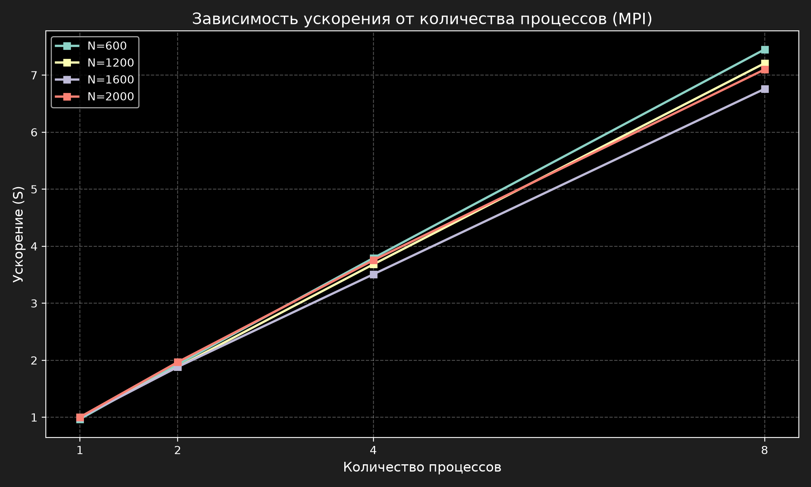

# Отчет по лабораторной работе №3

**Тема:** Параллельное умножение матриц с использованием технологии MPI и запуск на суперкомпьютере  
**Студент:** Судаков Антон  
**Группа:** 6211-10.05.03

---
## 1. Цель работы
Модифицировать программу умножения матриц из первой лабораторной для параллельной работы с использованием технологии MPI. Провести серию экспериментов на суперкомпьютере «Сергей Королёв» с разными размерами матриц и разным количеством вычислительных ядер (процессов).

## 2. Ход работы и реализация
В отличие от OpenMP, где потоки имеют доступ к общей памяти, в MPI каждый процесс изолирован и имеет свою собственную память. Поэтому алгоритм пришлось изменить: матрицы были переведены из двумерных векторов в одномерные массивы для удобной и быстрой передачи данных.

Также была написана последовательная версия программы (`seq.cpp`) для получения эталонного времени работы на 1 ядре, чтобы честно посчитать ускорение.

**Особенности запуска на СК:**
* Код адаптирован под старый компилятор GCC: убраны современные модули `import std;`, использованы стандартные библиотеки `<iostream>`, `<chrono>` и тп.
* Компиляция осуществлялась через Intel MPI: `mpiicpc -std=gnu++11 main.cpp -o mpi_prog -O3`.
* Запуск задач выполнялся через систему управления очередями Slurm с помощью скриптов.

## 3. Формулы для расчетов

**Ускорение (S) = Время(1 процесс) / Время(`x` процессов)**

**Эффективность (E) = Ускорение / Количество процессов**

## 4. Результаты экспериментов

Были проведены замеры времени (в секундах) для матриц размером от 200 до 2000 и количества процессов от 1 до 8.

### Таблица 1. Время выполнения (сек)
| Размер (N) | Seq (1 ядро) | MPI (1 проц.) | MPI (2 проц.) | MPI (4 проц.) | MPI (8 проц.) |
| :--- | :--- | :--- | :--- | :--- | :--- |
| 200 | 0.0158 | 0.0163 | 0.0096 | 0.0043 | 0.0024 |
| 400 | 0.0191 | 0.1263 | 0.0635 | 0.0327 | 0.0168 |
| 600 | 0.4023 | 0.4161 | 0.2088 | 0.1061 | 0.0540 |
| 1200 | 3.1770 | 3.1728 | 1.6872 | 0.8630 | 0.4408 |
| 1600 | 6.9867 | 7.0478 | 3.7134 | 1.9923 | 1.0338 |
| 2000 | 14.0033 | 13.9686 | 7.1190 | 3.7310 | 1.9727 |

### Таблица 2. Ускорение (S)
| Размер (N) | MPI (1 проц.) | MPI (2 проц.) | MPI (4 проц.) | MPI (8 проц.) |
| :--- | :--- | :--- | :--- | :--- |
| 200 | 0.97 | 1.64 | 3.63 | 6.41 |
| 400 | 0.15 | 0.30 | 0.58 | 1.13 |
| 600 | 0.97 | 1.93 | 3.79 | 7.44 |
| 1200 | 1.00 | 1.88 | 3.68 | 7.21 |
| 1600 | 0.99 | 1.88 | 3.51 | 6.76 |
| 2000 | 1.00 | 1.97 | 3.75 | **7.10** |

### Таблица 3. Эффективность (E, %)
| Размер (N) | MPI (1 проц.) | MPI (2 проц.) | MPI (4 проц.) | MPI (8 проц.) |
| :--- | :--- | :--- | :--- | :--- |
| 200 | 97% | 82% | 91% | 80% |
| 400 | 15% | 15% | 15% | 14% |
| 600 | 97% | 96% | 95% | 93% |
| 1200 | 100% | 94% | 92% | 90% |
| 1600 | 99% | 94% | 88% | 85% |
| 2000 | 100% | 98% | 94% | **89%** |

## 5. Графики

### Зависимость времени от размера матрицы

### Зависимость ускорения от количества процессов

## 6. Вывод

По результатам работы можно сделать следующие выводы:

1. **Максимальное относительное ускорение**: достигнуто на матрице 600x600 при использовании 8 процессов и составило **7.44x** (эффективность 93%). Это объясняется тем, что данные этого размера оптимально помещаются в кэш-память процессора. 
Для матрицы 2000x2000 ускорение составило **7.10x** (эффективность 89%). Небольшое снижение эффективности на больших размерах связано с насыщением пропускной способности оперативной памяти, однако именно здесь достигается максимальный абсолютный выигрыш по времени (с 14 секунд до 1.97 секунд).
2. **Накладные расходы:** На матрице N=400 видно резкое падение ускорения (эффективность всего 15%). Это связано с тем, что время на передачу сообщений между процессами (`MPI_Scatterv` и `MPI_Gatherv`) превышает время самих вычислений. На таких малых задачах использование MPI нецелесообразно.
3. Переход на одномерные массивы (`vector<int>`) позволил эффективно использовать память и корректно передавать блоки матриц между процессами. MPI показал себя как мощный инструмент для работы на распределенных системах (суперкомпьютерах).
